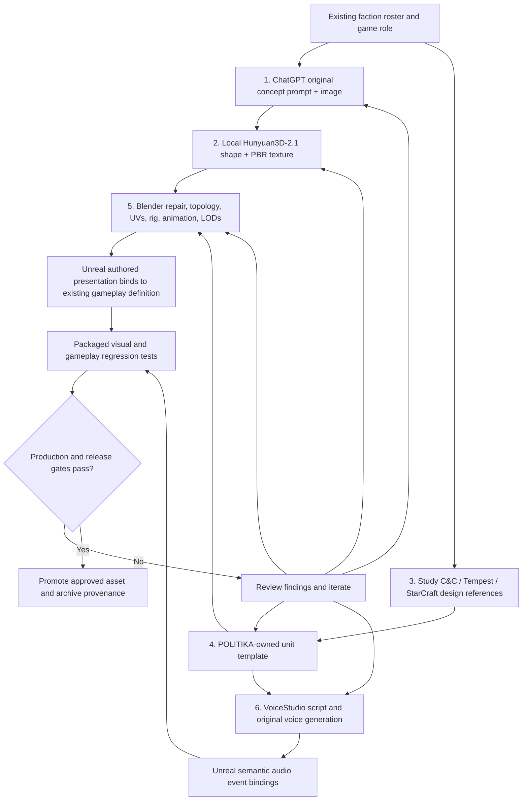

# POLITIKA — Low-Cost, AI-Assisted 3D Asset Production Workflow

**Status:** Proposed production pipeline / documentation only; not a claim that Hunyuan3D-generated content has been imported or accepted.  
**Date:** 2026-10-29  
**Engine target:** Unreal Engine 5.8.3  
**Primary production chain:** ChatGPT concept → local Hunyuan3D-2.1 mesh and PBR generation → C&C / Tempest Rising / StarCraft reference analysis → POLITIKA unit design template → Blender refinement and Unreal integration → VoiceStudio-authored audio → packaged-game verification.  
**Target hardware:** Linux, Windows, SteamOS/Steam Deck and Android are planned platforms, not all qualified builds.

## 1. Objective and governing principles

Create recognizable, period-coherent, reusable original POLITIKA infantry, vehicles, buildings, installations, aircraft and props at low marginal software cost, with work performed locally wherever possible. The generator supplies candidate **visual geometry and materials**. POLITIKA's unit design, authoritative gameplay data, command admission, movement, combat, economy, ownership, progression and event semantics remain independently authored and validated in the game's Unreal/C++ systems.

The production goal is a reproducible chain that can replace a temporary/reference model **without changing the gameplay contract unless a separate gameplay change is explicitly authorized**. A textured mesh is not automatically a skinned character, an animation-ready unit, a gameplay definition or a releasable asset.

**Non-negotiable boundaries:**

- **One authoritative gameplay definition.** Use stable content IDs and the existing Unreal data/content pipeline described in [ENGINE_OUTLINE.md](ENGINE_OUTLINE.md) and [GAMEPLAY_CONTENT.md](GAMEPLAY_CONTENT.md). A ChatGPT-generated YAML/Markdown template is a *review and authoring specification*, never a second runtime database.
- **Reference study is not asset ownership.** Examine Command & Conquer, Tempest Rising and StarCraft for archetype roles, silhouette legibility, animation/state coverage, command feedback and AI/UI affordances. The normal outcome is a newly authored POLITIKA asset. Extracted meshes, skeletal data, textures, voice clips and sound effects from those games are **protected reference material**, not distribution-ready POLITIKA content. Any permission-based reuse is a separate, explicitly cleared workflow.
- **Separate production and rights states.** A source can be technically imported and packaged yet remain excluded from public releases or a public source repository. Use the independent checks in [PRODUCTION_STANDARDS.md](PRODUCTION_STANDARDS.md) and [RTS_ASSET_RESOURCE_RESEARCH.md](RTS_ASSET_RESOURCE_RESEARCH.md).
- **No fabricated compatibility.** Image-to-3D generation does not establish rigging, animations, collision, skeletal compatibility, LOD quality, efficient materials or a successful Unreal cook.
- **Gameplay-camera approval first.** Recognizability at real RTS zoom and in battle takes precedence over extreme close-up detail, especially on smaller Steam Deck and Android displays.
- **Keep source materials traceable.** Every admitted candidate retains versioned prompts, generator settings, image and mesh hashes, human edits, reviews and test evidence. Large binaries should follow the repository's source-control/asset policy rather than being indiscriminately committed to Git.

## 2. Overall pipeline and responsibility boundaries



The steps are numbered by primary purpose; stages 3 and 4 can run in parallel with stage 2. No stage may silently copy a source game's numeric balance data or rewrite implemented POLITIKA gameplay.

| Stage | Primary input | Required output | Approval question |
| --- | --- | --- | --- |
| 1. Concept image | Faction canon, role and visual brief | Original prompt, concept image(s) and review sheet | Is the intended unit recognizable and visually original? |
| 2. Local generation | Approved concept, local Hunyuan configuration | Textured candidate mesh, PBR maps, generation manifest | Is the geometry complete enough to refine? |
| 3. Reference analysis | Licensed access to RTS titles, public design sources | **Text-only** mechanics/animation/audio/legibility reference dossier | What functional principles should be translated into original implementation? |
| 4. Unit template | POLITIKA roster and gameplay rules plus stage 3 dossier | Versioned design specification and mapping to existing gameplay identity | Does the definition fit faction, mechanics and current implementation status? |
| 5. Asset engineering | Candidate mesh plus approved unit template | Original `.blend`, optimized export, rig/animation/collision/LOD evidence, Unreal references | Does it actually work in the UE playtest at RTS zoom? |
| 6. Audio replacement | Original line scripts and semantic event catalogue | New voice recordings, audio manifest, SoundWave/Cue bindings and playback evidence | Are all required cues owned, audible, comprehensible and correctly triggered? |

## 3. Stage 1 — Create the concept in ChatGPT

Start from an existing faction roster row or approved custom archetype, e.g. `AC-INF-01` (*Professional Rifle Section*, proposed Atlantic Concord archetype). Distinguish the **squad-level gameplay archetype** from the **individual soldier mesh**: the concept image should depict one member when producing an individual infantry model. The existing C&C-inspired `RifleInfantry` presentation prototype is a different technical identity, not proof that an `AC-INF-01` production model is already accepted.

The prompt should specify faction, exact asset category, the 1984–1989 setting, military/civilian role, period-appropriate functional equipment, desired proportions, dominant material/color families, readable outline, and exclusions (no logos, text, recognizable third-party unit design or modern equipment unless intentionally alternate-history). Aim for an uncluttered studio presentation: single isolated subject, full body/object, no cropping, neutral background, soft even lighting, no elaborate effects, no motion blur. For characters, request a neutral **A-pose or T-pose** reference where appropriate so limbs, fingers and equipment are not merged; an attractive action pose can be generated separately as marketing art.

**Reusable ChatGPT concept prompt:**

> Create an **original POLITIKA 3D-model reference concept**, not a picture copied from another video game. Object: `[asset name]`; faction: `[faction]`; role: `[role]`; setting: alternate-history Yugoslavia, 1984–1989. Display exactly one complete `[individual soldier / vehicle / building]`, in a clean neutral studio setup, with readable mid-distance silhouette and period-consistent equipment. Design cues: `[faction silhouette, headgear, weapon family, material palette, insignia policy]`. For a humanoid, use a relaxed neutral pose with separated limbs and clearly visible gear; for a vehicle, make wheels/tracks, turret, barrels and attachments distinct. Show coherent color and physical material zones suitable for later PBR reconstruction. Do not include words, captions, watermarks, scenery, extra figures, brand logos or obvious C&C/StarCraft/Tempest designs. Use one consistent object identity and realistic mechanical construction. This image will be input to a local image-to-3D generator, so avoid occlusion and ambiguous geometry.

Produce a **primary generation image** and optional **front, side, back and three-quarter inspection views**. Do not automatically submit an inconsistent multi-panel collage to a single-image inference workflow. Confirm that all views show the same object. Archive the final prompt, selected image, rejected candidates, concept revision and rationale.

**Gate C1:** original-looking design; coherent faction identity; no occluded critical parts; sufficient silhouette clarity at a mock RTS viewing angle; human review of period/technology and historical symbols.

## 4. Stage 2 — Generate a textured 3D candidate with local Hunyuan3D-2.1

Hunyuan3D-2.1 is the selected **local** generator for this workflow. Its published architecture separates **Hunyuan3D-Shape** (image → mesh) and **Hunyuan3D-Paint** (mesh + image → PBR-textured output); its project README documents a local Gradio interface and Python API. Use the specific installation already available on the production machine rather than assuming a service URL, exact wrapper CLI, preinstalled extensions or identical output formats. See the [official project](https://github.com/Tencent-Hunyuan/Hunyuan3D-2.1).

Procedure:

1. Submit the stage-1 approved primary image to the locally installed shape stage; retain the selected image bytes and generator/run ID.
2. Generate mesh candidates with reproducible settings (model/checkpoint identifier, tool commit, seed where supported, inference options, image dimensions, geometry resolution, execution device and date).
3. Inspect the untextured geometry before running the paint stage. Reject missing limbs, melted weapons, fused wheels, hollow/inverted parts, impossible undercuts or unusable silhouettes. Re-prompt or resample rather than trying to repair a wholly unsuccessful topology.
4. Run the texture/PBR stage using the approved image and selected geometry. Export the model and texture maps in whatever files the **verified local configuration** actually supports; do not assume the generated mesh includes production-ready metallic, roughness, normal or AO channels until inspected.
5. Stage an unmodified generator output in a **candidate-only** workspace; record file sizes, actual mesh/texture formats, image-to-mesh correspondence and SHA-256 hashes.
6. Compare neutral-clay, base-color and material-lit turntable views with the concept. Flag painted-on weapons, false geometry, inconsistent left/right sides and baked lighting baked into albedo.

**Generator limits to expect:** a textured static mesh is generally *not* a tested skeletal mesh. Automatic UVs may be inefficient; topology may be dense, non-manifold or unsuitable for skinning; floating parts may require parenting; materials may need PBR corrections. For infantry, **retopology and rigging are separate mandatory tasks**, not optional postprocessing.

**Hardware note:** Tencent's README lists substantial GPU-memory requirements for shape and texture stages (roughly 10 GB and 21 GB respectively, with different combined requirements). Treat these as publisher-provided figures, not measured local requirements; enable documented low-VRAM settings or smaller jobs only after validating the machine and actual performance.

**Gate C2:** complete intended shape; acceptable texture coverage; no crucial fused parts; inspectable/exported files; reproducible metadata. A candidate failing this gate never advances straight into the gameplay Content tree.

## 5. Stage 3 — Examine corresponding RTS objects as design references

The purpose is to study **functional ontology**: what makes an RTS unit understandable and operable, rather than copying a commercial game's implementation or media. Candidate sources include Command & Conquer (infantry selection/acknowledgment, squad/member differentiation, combat readiness), Tempest Rising (modern RTS presentation and design organization), and StarCraft (readability, role differentiation and state signaling). Inspect actual evidence available to the team and distinguish direct observations from inferred rules.

For each comparison, capture:

| Dimension | Questions to answer | POLITIKA translation |
| --- | --- | --- |
| Tactical identity | What is the unit's class, battlefield role and target relationship? | Define original role, targeting eligibility and counterplay |
| Entity granularity | One combatant, squad container, vehicle with subcomponents, or building? | Do not treat a six-member C&C squad as six independently controllable POLITIKA actors without an explicit design and implementation decision |
| Presentation silhouette | How is it differentiated at camera zoom, in crowds and across faction palettes? | Define a distinct POLITIKA silhouette and selection footprint |
| Animation grammar | Idle, ready, move, turn, fire, attack-move, reload, hit, suppress, die, deploy, garrison, special? | Author a **required/optional state coverage matrix**; link only to mechanics the game actually supports |
| Movement/selection | Collision profile, formation spacing, stance and selection feedback? | Map to existing POLITIKA movement/selection interfaces, not the other title's hidden movement logic |
| Weapons/effects | Muzzle socket, projectile/tracer concept, impact effect, reload cue? | Specify visual/sound hooks separately from authoritative damage calculations |
| Audio | Selection, move, attack, invalid order, under fire, destroyed, mechanical loops? | Generate new recordings and map them to POLITIKA semantic event IDs |
| Efficiency | Approximate onscreen scale, LOD behavior, batching opportunities? | Set evidence-based POLITIKA desktop/handheld/mobile performance targets |

Write the dossier in your own descriptive language. Record observed source title, edition/build when known, material examined, screenshots/files retained only in permitted private reference storage, evidence quality, and the design decision. Do **not** transplant source skeletons, extracted W3X/W3D/SC2/Unreal package contents, sound banks, animations or textures into the new production asset merely by renaming, re-encoding, retargeting or retexturing them. If a source's exact data was not inspected, label it `unverified`.

**Existing case:** [CNC3_RIFLEMEN_IMPORT.md](CNC3_RIFLEMEN_IMPORT.md) documents the local `RifleInfantry` reference prototype and accepted Linux playtest behavior, while explicitly leaving source-media redistribution unresolved. This historical evidence is valuable as a test baseline. It is **not** blanket authorization to migrate the extracted rig, skeleton, sound banks or converted textures into production.

**Gate C3:** a provenance-labeled, text-first reference dossier with an explicit mapping of observed design principles to proposed POLITIKA responsibilities. Direct media reuse is excluded unless separately authorized.

## 6. Stage 4 — Author the original POLITIKA unit template

ChatGPT combines the faction roster and existing game mechanics with the comparison dossier to prepare a **design template**. The template can guide authoring and reviews but must not independently control gameplay. The game's stable runtime definition remains an existing or explicitly created Unreal content definition; its accepted ID, unit ownership, weapon definitions, command permissions, resource costs and AI behavior are governed by the real implementation, not by a prompt.

**ChatGPT template generation prompt:**

> Write an original POLITIKA unit **production specification** for `[roster ID / unit]` in `[faction]`. Use the current faction canon and the separately provided RTS reference observations as design evidence, not as media or numeric values to copy. Include identity, faction, role, playable/NPC status, individual-mesh versus squad/container distinction, weapon class, target classes, movement class, supported and proposed commands, appearance, rig and animation-state requirements, material and LOD needs, selection/collision/attachment points, original voice-line categories, sound-event semantics, VFX hooks, platform verification and release-readiness checks. Clearly label `implemented`, `approved design`, `proposed` and `unknown`. Keep balancing numbers and Unreal asset paths `TBD` unless verified in the current POLITIKA source. The specification is an authoring template, not a new runtime data registry.

**Illustrative template — not validated gameplay data:**

```yaml
schema: politika-asset-spec/v1
asset_design_id: AC-INF-01
name: Professional Rifle Section
faction: TheAtlanticConcord
unit_domain: ground
category: infantry
entity_granularity: squad_proposal
rendered_subject: single_soldier_member
roster_status: proposed
runtime_unit_definition: TBD      # Resolve to existing UE definition when integrated
prototype_comparison: presentation.playtest.rifle_infantry
roles: [general_purpose_rifle_infantry, area_security]
weapon:
  kind: small_arms_rifle
  specific_model: TBD
  firing_mode: TBD
  damage_range_costs: TBD          # Authoritative gameplay definitions own numbers
movement:
  kind: infantry_ground
  simulation_profile: TBD
visual:
  palette: restrained_cold_war_western_inspired
  silhouette: helmet_backpack_visible_rifle
  original_insignia: TBD
  parts: [head, torso, arms, legs, rifle, equipment]
  critical_sockets: [muzzle, left_hand, right_hand]
animations:
  require_for_first_integration: [idle, move, fire, death]
  future_if_supported: [reload, attack_move, suppression, garrison, stance]
audio_semantics:
  require: [unit_selected, order_acknowledged]
  proposed: [order_attack, under_fire, death]
rig:
  source: original_or_permitted_skeleton
  compatible_with_current_prototype: untested
performance:
  lod_count: benchmark_determined
  texture_budget: benchmark_determined
implementation_state: design_only
production_rights_state: review_required
```

A `[TBD]` / `unknown` field must not be interpreted as an implicit mechanic. When the same template is used for a tank, aircraft or structure, substitute a domain-specific geometry/animation/interaction contract: turret rotation, track or wheel motion, doors, deployable parts, damage layers, landing gear, production attachment points, footprints and construction stages as appropriate.

**Unit composition rule:** a squad-level unit definition may reference an authored single-soldier mesh for several visual members, but selection, health, casualty, formation, pathing and attack semantics require explicit game-side support. Never infer an implemented squad simulator from having multiple meshes.

**Gate C4:** gameplay owner approves the ID and existing/new definition relationship; art owner approves appearance/animation requirements; no conflict with the [five-faction roster](POLITIKA_FIVE_FACTION_ROSTERS.md), faction canon, historical constraints or gameplay data authority.

## 7. Stage 5 — Construct the production asset and integrate into Unreal

Use Blender as the editable intermediary. Input is the **new Hunyuan-generated candidate**, not a source-game mesh. The reference dossier contributes requirements, while the POLITIKA template contributes identity, attachments and intended behavior. Use the existing source-controlled Unreal project and importer behavior as the integration baseline.

### 7.1 Geometry, materials and rigging

1. Import the generator output into Blender; preserve an immutable unmodified version and record scale/orientation.
2. Clean non-manifold and self-intersecting geometry, face normals, hidden interior faces, disconnected accessories and excessive material slots. Rebuild topology for moving joints and simplify thin features unlikely to survive RTS zoom.
3. Check a real unit scale (Unreal centimeters; Z-up). Establish consistent forward orientation and an appropriate origin/pivot; verify on the existing test map rather than relying on an arbitrary conversion multiplier.
4. Build clean UV islands and bake/repair base color, normal, roughness, metallic and optional AO maps as actually needed. Avoid baking directional sunlight into the base-color texture. Preserve a cohesive faction material family.
5. For infantry, **create or license a usable skeleton**, bind skin weights, test major joints and retarget only from a permitted source. The currently imported reference prototype's skeleton is not presumed rights-cleared for production. Verify neutral pose and root motion policy against existing POLITIKA movement authority.
6. Create/retarget appropriate animation sequences. Minimum for the rifleman replacement test: idle, locomotion, firing and death, plus any currently bound transitions needed to preserve the working prototype. Separate animation presentation from whether an attack or movement order is actually admitted.
7. Provide muzzle/hand/equipment sockets, selection bounds, hit/selection feedback, physics/collision primitives and navigation footprint as specified. Gameplay collision may intentionally be simpler than render geometry.
8. Generate LODs and material variants, test dense-unit scenarios and use measured platform budgets. Do not prescribe a universal triangle or texture limit without packaged benchmarks. Repeated battlefield infantry may require more aggressive reduction than one-off hero models.
9. Keep a `.blend` source and export a verified, interoperable Unreal input such as **FBX for skeletal/animation assets**; GLB/glTF can remain useful for interchange and static asset inspection when the project's actual import route supports it. Validate exporter/importer behavior, including Unreal 5.8 FBX pipeline settings.

Epic's [FBX Skeletal Mesh Pipeline](https://dev.epicgames.com/documentation/en-us/unreal-engine/fbx-skeletal-mesh-pipeline-in-unreal-engine), [FBX Animation Pipeline](https://dev.epicgames.com/documentation/unreal-engine/fbx-animation-pipeline-in-unreal-engine) and [Skeletal Mesh LOD Import](https://dev.epicgames.com/documentation/en-us/unreal-engine/importing-skeletal-mesh-lods-using-fbx-in-unreal-engine) document the applicable mesh, animation and LOD concepts. Confirm the existing project's configuration before changing import behavior.

### 7.2 Integration without gameplay regression

- Stage the new authoring files separately; do not overwrite the current accepted `RifleInfantry` content or delete reference/provenance records.
- Bind the new skeletal mesh and its animation blueprint/presentation profile to the **existing test entity** first. The existing C++ runtime remains the owner of selection, orders, combat, health, death and events.
- Keep prototype presentation paths and production archetype IDs conceptually distinct. `AC-INF-01` is presently a **proposed faction roster ID**; `/Game/Politika/Prototypes/Infantry/RifleInfantry` is the documented retained rifle-infantry prototype path.
- Map sockets to muzzle/VFX and attachable equipment, and map animation states to authorized entity-state observations; presentation must not issue gameplay damage or change resources by itself.
- Run the existing importer/acceptance workflow only after inspection. Preserve dirty worktrees, current main, authored Unreal assets and the verified engine pin; use isolated implementation worktrees for changes as appropriate.
- Compare packaged test results against the currently accepted Linux baseline: one-unit selection, move, attack, damage/death, audio events, objective behavior, return to menu and any current checks. A clean Editor import is **not** a cooked playtest acceptance.

**Gate C5:** correct real-world scale and pivot, clean materials, correct rig + deforming animations where applicable, visible LODs, collision/selection tests, actual package cook and no relevant command/gameplay regressions. Performance evidence must name the tested build, OS, map, zoom, unit density and resolution.

## 8. Stage 6 — Create original unit audio with VoiceStudio

VoiceStudio is the selected **new-audio authoring** stage. Record the exact VoiceStudio product/version and its real supported export formats at the time of work; do not assume a particular API or that it generates convincing firearm/vehicle Foley. Prepare short original scripts that reflect POLITIKA's faction, military role and 1980s radio style, and generate distinct speaker identities and controlled delivery without cloning or imitating commercial-game performers or real individuals without permission.

For an infantry prototype, create a small speech set covering selected, acknowledged movement, acknowledged attack, negative/invalid action when supported, under fire, retreat when supported and death/last response only where narratively suitable. Vehicles and buildings use different sets; non-voice effects (rifle shots, engines, motors, impacts, machinery, radio/static and ambience) require separate original synthesis/recording or suitable licensed source material and are not solved simply by voice replacement.

| POLITIKA semantic event | Suggested original line role | Typical bus | Binding rule |
| --- | --- | --- | --- |
| `unit_selected` | Selection acknowledgement where a spoken voice is desired | `voice` or `ui` according to event design | Do not force a voice onto a UI-only event definition |
| `order_acknowledged` | Move/attack/ability acknowledgement, optionally contextualized by order type | `voice` | Existing event ID; extend with distinct typed events only through reviewed gameplay/audio changes |
| `combat_warning` | Warning or concise radio alert | `ui` or `voice` by authored routing | Critical warning needs visual equivalent |
| `vehicle_movement` | Engine/track/rotor loop rather than speech | `sfx` | Source externally from original/cleared SFX workflow |
| `propaganda_broadcast` | Fictional radio broadcast/voice narrative | `broadcast` | In-world reports do not redefine authoritative world truth |

`Data/audio_events.json` already contains a **planned semantic catalogue** (including `unit_selected`, `order_acknowledged`, `combat_warning`, `vehicle_movement` and `propaganda_broadcast`). Respect its implemented/planned distinctions and do not treat illustrative new line types as existing event IDs. See [PRODUCTION_STANDARDS.md](PRODUCTION_STANDARDS.md) for audio-bus policy and [ART_AUDIO_REFERENCE_STUDY.md](ART_AUDIO_REFERENCE_STUDY.md) for reference-derived event design principles.

**Practical audio procedure:**

1. Generate and approve original line scripts (with tone, situation, language and pronunciation notes). Keep lines short enough to work in dense RTS order traffic.
2. Generate original performances in VoiceStudio, with distinct voice/profile identification; record settings, version, scripts, prompt, seed when available and output hashes.
3. Export a lossless source/interchange master if supported (e.g. 48 kHz PCM WAV); retain the original generated format otherwise and convert **only** after verifying quality. Unreal's actual platform compression is an engine-side decision.
4. Normalize and clean noise, silence, peaks and loudness consistently; avoid clipping, exaggerated radio filtering and excessive reverb. Generate controlled variations rather than repeating one fatiguing phrase.
5. Import into Unreal as appropriate SoundWave and cue/routing assets; attach to validated semantic event bindings. Test concurrency, cancellation on deselection/death/level travel, voice priority, spatialization, subtitles and voice-volume controls.
6. Verify audio in a **real packaged match** with multiple units, rapid selection and overlapping combat. Audio-log events alone do not prove audible or intelligible output.
7. Replace and quarantine proprietary audio references from any distribution candidate, then confirm the **cooked package** contains only approved final audio. Renaming or transcoding an extracted source clip is not replacement.

**Gate C6:** original/approved voice and SFX provenance; no old commercial-game recordings in the distribution artifact; correct event routing; clear repeat behavior; audibly verified package playback with visual/caption alternatives where required.

## 9. Proposed file organization and reproducibility

This is an **example source workspace layout**, not an assertion that these paths already exist or a mandate to move current production files. Align it with existing `Art/`, `Docs/`, `Tools/`, Unreal `Content/`, and Git-LFS/source-control policy at implementation time.

```text
Art/ProductionSources/<FACTION>/<ASSET_ID>/
  specification.md                  # Human-approved ChatGPT-derived design and status
  concept/
    prompt.md
    main.png
    review.md
  generated/
    generation-manifest.json        # Model revision, input hashes, options, dates
    source-model.glb                # Example only: actual generator output varies
    textures/                       # As-produced material sources
  blender/
    production.blend                # Editable mesh, UV, skeleton, original edits
  exports/
    mesh.fbx                        # If skeletal FBX is chosen/verified
    animations/                     # Separately validated animations
  audio/
    script.md
    voice-generation-manifest.json
    masters/                        # Original approved/lossless audio sources
  QA/
    silhouettes/                    # Actual RTS zoom contact sheets
    reports/                        # Import/cook/functional/performance tests
    rights-review.md
```

Keep protected reference material **outside** publicly distributed trees and cooked content, with its private provenance and checksum ledger. Avoid public-committing huge intermediate results; decide whether particular original files belong in Git, Git LFS, release archives or reproducible offline local storage. The final Unreal `Content/` paths should reflect the established definition/presentation hierarchy instead of becoming a second independent data repository.

**Minimum run manifest fields:** `asset_design_id`, `run_id`, `input_image_sha256`, `concept_revision`, `generator_name/version/commit`, `shape_checkpoint`, `texture_checkpoint`, `settings`, `seed_if_supported`, `output_files/hashes`, `Blender_version`, `mesh_triangle_count`, `texture_map_inventory`, `skeleton_name_and_origin`, `export_format`, `Unreal_engine_pin`, `Unreal_destination`, `test_build_revision`, `test_outcomes`, `source_rights_status`, `public_redistribution_status`, `reviewer/date`. Hashes are of actual files and must never be guessed.

## 10. Acceptance checklist and production statuses

**Independent status axes**—do not compress these into a single `ready` flag:

- **Design:** proposed → concept approved → technical specification approved.
- **Geometry:** generated candidate → Blender cleanup → rigged/optimized (where applicable) → Unreal import verified.
- **Integration:** imported → bound to existing gameplay → cooked → packaged gameplay and media verified.
- **Rights:** unknown/protected reference → item-reviewed → cleared with obligations or excluded. The state `technically working` is not equivalent to `redistribution permitted`.

| ID | Test | Required evidence |
| --- | --- | --- |
| `ASSET-C1` | Concept silhouettes and faction/period coherence | Original images and human approval record |
| `ASSET-C2` | Mesh + PBR output is inspectable and matches concept | Raw export, generation manifest, turnaround screenshots, mesh QA |
| `ASSET-C3` | Source-game references are translated into original requirements | Text-first comparison dossier with separate evidence and assumptions |
| `ASSET-C4` | Unit template respects current gameplay definitions | Human-approved specification; `TBD`/planned distinctions |
| `ASSET-C5` | Mesh scale, topology, skin weights, sockets, LOD/collision pass | Blender checks, Unreal import diagnostics, pose/LOD captures |
| `ASSET-C6` | Visual readability from actual RTS camera | Identical-scale screenshot comparison in daylight, low light, clutter and faction colors |
| `ASSET-C7` | Animation states display without changing simulation truth | Existing automated checks plus packaged move/fire/death inspection |
| `ASSET-C8` | VoiceStudio speech and other audio are newly authored and properly triggered | Audio manifest, cue mapping, subtitles/concurrency checks, recorded playable output |
| `ASSET-C9` | Prototype replacement preserves the previously accepted behavior | Defined regression suite and build+package identity |
| `ASSET-C10` | Performance is measured for intended device classes | Hardware/map/unit count/zoom/render-resolution metrics; optimize if failing |
| `ASSET-C11` | Distribution package and public repository are separately cleared | Rights review, source/provenance record, cooked manifest scan |

A new file in the repository does not equal an imported asset. A successful importer does not equal a rendered test. A successful cook does not equal a sound played on a real device. A functional reference prototype does not equal a cleared production asset.

## 11. First pilot — original replacement for the existing rifle-infantry presentation

**Pilot goal:** prove one complete original infantry path while leaving existing runtime combat and unit semantics unchanged. The pilot's art direction may follow proposed `AC-INF-01` but must explicitly resolve whether the selected presentation is for the generic `RifleInfantry` prototype or a new faction-specific archetype. Do not silently rename the existing gameplay entity to a squad type.

1. Derive a single-soldier concept from `AC-INF-01` roster canon; approve one neutral-pose primary image.
2. Produce one local Hunyuan3D mesh+texture run; retain raw files and exact settings.
3. Write a short comparison dossier based on C&C rifleman, Tempest Rising infantry, and StarCraft basic infantry design behaviors **only to the extent actually observed**.
4. Approve a specification for the original POLITIKA rifleman visual, sockets and required animation states; keep gameplay values as currently implemented.
5. Retopologize, UV/bake, rig to an original/permitted skeleton and create/retarget idle, run, fire and death clips; test against the reference playtest presentation without overwriting it prematurely.
6. Generate new selection, move and attack voice variants in VoiceStudio. Create original or approved rifle-fire and footstep SFX separately.
7. Import into an isolated Unreal presentation candidate. Preserve the existing accepted `RifleInfantry` source, packaged baselines and provenance for comparison.
8. Build/cook/package on pinned UE 5.8.3; exercise selection, move, attack, death, feedback audio, objective behavior and menu return in the same scenario. Compare silhouette at real camera scale, animation fidelity, file/memory cost and frame performance.
9. Promote only when technical, player-facing and rights gates all pass; retain before/after evidence and a reversible asset mapping.

**Definition of done:** a newly authored, skinned and textured individual soldier is visible in the actual packaged POLITIKA playtest, follows the existing authoritative command/combat behavior, animates correctly, plays new approved audio, is recognizable at RTS zoom, has a traceable build/source manifest and can replace the reference presentation without regressions. Until then, it is a **candidate**.

## 12. Future extensions

Once the infantry pilot passes, generalize the same six-stage structure to static civilian props/buildings (no humanoid rig), vehicles (separate turret/wheels/tracks and damage modules), aircraft (rotors/landing gear/flight presentation), production structures (construction and destruction stages), and commander/elite units (additional stances/abilities and stronger silhouette requirements). Batch related units by shared original rig, material atlas, animation vocabulary, faction motifs and audio event grammar; **do not** batch unlike assets into a single topology/rig or force different classes through an infantry-specific importer.

Automation candidates include a manifest validator, offline Blender mesh inspection/bake pipeline, view-capture generator, UE asset reference checker, forbidden-source media scan, SoundWave/Cue binder, and packaged performance benchmark. Build each tool only after the corresponding manual pilot has established a trustworthy input/output contract. Keep this production workflow subordinate to [ENGINE_OUTLINE.md](ENGINE_OUTLINE.md), [PRODUCTION_STANDARDS.md](PRODUCTION_STANDARDS.md) and relevant acceptance records.

## References

- [Hunyuan3D-2.1 official source and usage](https://github.com/Tencent-Hunyuan/Hunyuan3D-2.1)
- [Unreal Engine 5.8 — FBX Skeletal Mesh Pipeline](https://dev.epicgames.com/documentation/en-us/unreal-engine/fbx-skeletal-mesh-pipeline-in-unreal-engine)
- [Unreal Engine 5.8 — FBX Animation Pipeline](https://dev.epicgames.com/documentation/unreal-engine/fbx-animation-pipeline-in-unreal-engine)
- [Unreal Engine 5.8 — Skeletal Mesh LODs](https://dev.epicgames.com/documentation/en-us/unreal-engine/importing-skeletal-mesh-lods-using-fbx-in-unreal-engine)
- [Existing rifleman import and test evidence](CNC3_RIFLEMEN_IMPORT.md)
- [Production art/audio standards](PRODUCTION_STANDARDS.md)
- [Asset sourcing and rights review](RTS_ASSET_RESOURCE_RESEARCH.md)
- [Existing audio/event design study](ART_AUDIO_REFERENCE_STUDY.md)