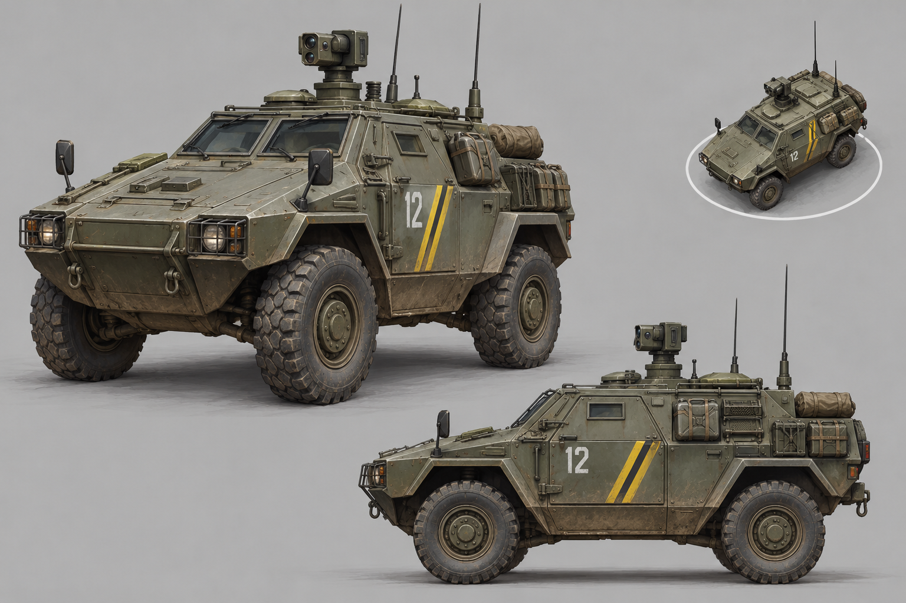

# C&C visual/audio reference study and POLITIKA asset prototypes

**Purpose:** record local-file observations that can guide original POLITIKA art and sound. References were inspected locally; no C&C files were copied into the POLITIKA asset tree. This is production research, not a statement that the concept or sound has been approved, imported into Unreal, or cleared for final release.

## Reference observations

| Reference | Direct observation | Useful lesson for POLITIKA | Limits |
|---|---|---|---|
| Generals DDS texture `Textures/Art/Textures/cbnapunit_d.dds` | A 256×256 DXT5 atlas contains multiple weathered wall/door/window regions with distinct damage and color variation. It was converted only to a temporary PNG for inspection. | Small atlases can support environmental variety, but at RTS camera height the wall/roof silhouette and material grouping should carry more information than tiny surface grime. POLITIKA textures should be purpose-authored, tiled/packed carefully, and tested under terrain lighting. | The file’s internal naming alone does not establish its model binding; the image was viewed in isolation. |
| Generals original W3D model samples, e.g. `W3D/Art/W3D/CBBunker01_EN.W3D` | The files are present as binary W3D assets and are named by apparent object/material variant. The installed Blender setup has no verified W3D importer, so the model geometry was not previewed. | Keep model-source format and material/LOD dependencies explicit. Do not infer scale or silhouette from filenames; inspect in a supported viewer/import pipeline before making asset-specific judgments. | Unpreviewed; no geometry, animation, or in-game scale claims are made. |
| C&C4 terrain TGA, e.g. `Terrain/art/terrain/aua_buildingground01.tga`, plus `_nrm` companions | The extraction separates diffuse-like terrain images and normal-map variants into themed terrain paths; naming groups assets by biome/context. | Build a coherent POLITIKA regional material family (Adriatic/coastal, Dinaric highland, Pannonian/plain, industrial/urban) and preserve a restrained material hierarchy so roads, cover, mud, concrete, and vegetation read at strategic zoom. | Extracted files were not checked in the C&C4 runtime; exact material channel semantics need shader/manifest interpretation. |
| C&C4 and RA3 APT package manifests (`Apt/data/aptui/*.manifest`, with `.imp`, `.bin`, `.relo`) | UI is decomposed into named screen, HUD, objective, button, and interaction packages rather than a single monolithic screen. | Maintain semantic, reusable POLITIKA UI assets: state icons, command buttons, objective markers, selected-unit details, warnings, and faction elements should have discrete roles and scalable variants. At 4K, preserve hierarchy and readable hit targets, not simply pixel-scale old layouts. | These manifests describe package organization; they do not prove POLITIKA should copy their layout or appearance. |
| Generals `SoundEffects.ini`, `AudioEvent GUIClick`, `GUIMessageReceived`, `GUICommandBarClick`, `CivPropPlaneAmbientLoop` and associated WAV members | Events group one-shot interface cues and ambient variations by semantic event; definitions specify bus/type, priority, volume, loop/decay, and pitch/volume variation. The WAV sample `vprolo1b.wav` is a short 22.05 kHz mono member of the civilian-prop-plane ambient loop. | Name POLITIKA audio by gameplay meaning, separate UI/voice/SFX/ambience/broadcast buses, set priority and concurrency, and use controlled variation for repeated ambience. Critical warnings need a visual equivalent and must remain intelligible over ambience/music. | The sample’s event assignment was inspected; it was not used or copied. Acoustic judgments about the original mix are not claimed. |

## Design implications

- **Camera-first modeling:** approve models by silhouette, role recognition, faction marking, selection bounds, and damage state at gameplay scale. Use close-up renders to inspect finish, never as the sole approval view.
- **Texture hierarchy:** assign texel/detail budgets by functional importance; make road edges, rooflines, cover, faction markings, and damage readable before adding fine scratches or text.
- **Icon language:** use one POLITIKA-owned shape grammar. Separate category and state (infantry/vehicle/building; available/cooldown/disabled/contested) with shape, value, and labels—not color alone. Supply high-DPI and compact-screen variants.
- **Animation/feedback:** every key state change needs a legible visual response: selected, moving, firing, suppressed, damaged, repairing, ability active, and order rejected. Keep loops short or state-based; avoid busy idle motion that competes with battlefield events.
- **Audio taxonomy:** keep unit voice/command acknowledgments distinct from UI clicks, combat alerts, machinery/weapon SFX, regional ambience, music, and in-world broadcasts. Use ducking/priority and event throttling; never let repeated selection or warning sounds become a continuous alarm.
- **Asset provenance:** this study references proprietary game assets only as local analytical material. It does not grant rights to copy textures, meshes, UI, animations, audio recordings, or branding into POLITIKA. Production files here are newly generated prototypes with their provenance recorded.

## Original POLITIKA concepts created from the study

### Unaligned federal reconnaissance 4×4 — visual concept

The original 1536×1024 concept sheet explores a compact angular 1980s federal scout/command vehicle. Its high-contrast roof sensor/antenna silhouette and restrained yellow service stripes aim to remain identifiable at RTS zoom; practical stowage and weathered olive/grey paint support the period. It avoids national flags and C&C iconography. This is **concept art only**, not a historically verified vehicle, production model, approved insignia, or final game asset. Verify historical references and redesign any questionable details before promoting it.

### Radio order-acknowledgment cue — audio prototype

[`radio-ack-prototype.wav`](../Art/Audio/Prototypes/radio-ack-prototype.wav) is a newly synthesized 0.42-second mono cue: brief low-level radio hiss followed by two short descending tones. It uses no source recording and is intended only to explore an unobtrusive, repeatable acknowledgment separate from a spoken unit voice line. Its source is [`generate_radio_ack.rs`](../Art/Audio/Prototypes/generate_radio_ack.rs). It is not yet attached to the `order_acknowledged` event, mixed against gameplay, or accepted for use; review bus assignment, volume, accessibility, and rapid-repeat behavior first.

## Next production step

Promote only after checking the concept against period photo/reference research and faction canon, then create a Blender blockout/model with consistent scale, pivot, collision, LODs, and material family. Review a greyscale silhouette/contact sheet at real camera scale and test markings under fog, night, damage, and color-vision settings. For audio, compare the prototype with original/commissioned spoken acknowledgment and alert options in a busy mix; retain a visual acknowledgment and adjustable/disableable cue level.
