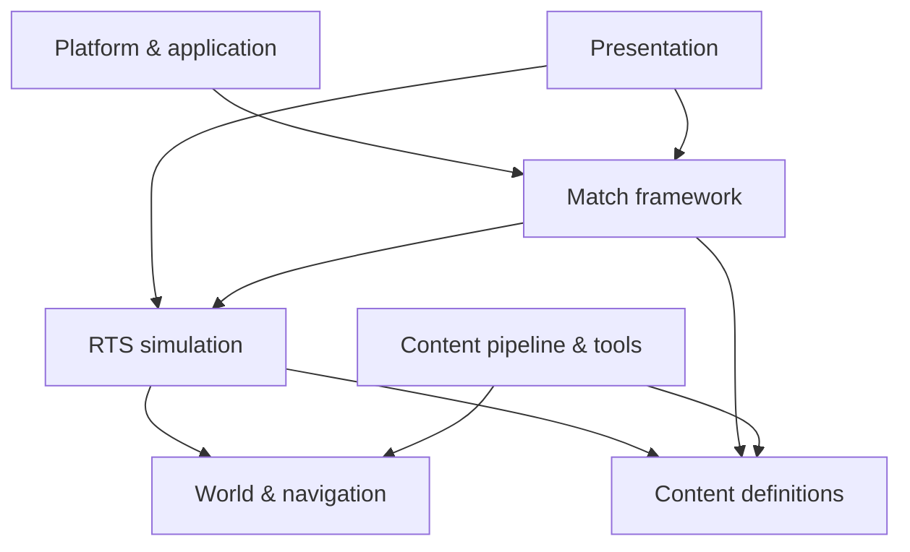

# POLITIKA — Proposed Engine Layers

**Status:** first-pass architecture proposal, 2026-10-27
**Target runtime:** Unreal Engine 5.8.3
**Reference example:** Command & Conquer 4: Tiberian Twilight
**Product constraints:** offline play without mandatory account login; no cinematic sequences; 4K-capable UI and rendering

## 1. Purpose

This document expands the “Proposed layers” table in [ENGINE_OUTLINE.md](ENGINE_OUTLINE.md). It uses C&C4 as a structural reference for separating application shell, gameplay runtime, packaged content, and authoring tools. It does **not** assume that POLITIKA should copy C&C4's executable architecture, technology, or strategic rules.

The core boundary is:

> The simulation owns gameplay truth. Presentation reads that state and submits player commands. Content defines values and authored scenarios. Platform/application code lets the game start and run locally without requiring an external identity service.

## 2. Layer map

| Layer | Owns | Unreal-facing implementation |
|---|---|---|
| Platform & application | Startup, local settings/saves, input devices, display modes, localization, launch/quit | `UGameInstance`, `UGameUserSettings`, Enhanced Input, `USaveGame`, platform abstraction |
| Presentation | Camera, HUD, menus, visual/audio feedback, animation and in-game dialogue | PlayerController, camera components, UMG/CommonUI, Niagara, Audio, animation systems |
| Match framework | Match/mission lifecycle, players/teams, rules, objectives, pause, victory/defeat and results | GameMode/GameState/PlayerState plus POLITIKA match/mission subsystems |
| RTS simulation | Orders, movement, targeting, combat, health/status, abilities, resources and vision | C++ gameplay systems/components with explicit state and command interfaces |
| World & navigation | Maps, terrain, roads, cover, blockers, playable bounds, pathing and visibility queries | UE World/landscape plus RTS-specific navigation, region/cost and visibility data |
| Content definitions | Factions, units, weapons, abilities, upgrades, objectives, AI and mission parameters | Primary Data Assets/DataTables, reusable C++ behavior types, validated references |
| Content pipeline & tools | Map authoring, import, validation, localization, balance iteration and packaging | UE Editor tooling, WorldBuilder-like authoring workflows, command-line validators/build automation |

These are logical boundaries, not a demand for seven separate binaries or modules. Start with a small number of Unreal modules and preserve the dependencies shown below; split modules when the codebase needs independent ownership or build boundaries.

## 3. Layer responsibilities and C&C4 comparison

### 3.1 Platform & application

**POLITIKA responsibility:** provide a direct path from process launch to the main menu and local play. Own settings, display/resolution changes, input-device setup, local profile/save data, language selection, and orderly shutdown. A missing network connection must not prevent campaign or local skirmish access. Do not require account creation, sign-in, or remote entitlement checks for offline content.

**UE direction:** use GameInstance-level startup/settings coordination, GameUserSettings for display/scalability, Enhanced Input for device and mapping setup, and SaveGame/local config for progress and options. Hide platform-specific storage and distribution details behind a small adapter so game rules do not depend on Steam or another storefront.

**C&C4 evidence and lesson:** the latest REA inspection identifies `CNC4.exe` as a managed x86 CIL launcher, separate from `Data/CNC4.game`, the native x86 game executable. Launcher metadata contains named areas such as patch checking, user login, persona creation/selection, and configuration/hash providers. This proves that a substantial launcher/account surface exists in the artifact; the static inspection does not establish which flows execute or when. POLITIKA should not inherit that login/patch-gate pattern because it conflicts with the offline-first product requirement.

### 3.2 Presentation

**POLITIKA responsibility:** make battlefield state understandable and commands responsive. Own camera controls, selection presentation, HUD, menus, cursor/target modes, alerts, animation, VFX, sound, and in-game dialogue/subtitles. Presentation must not be authoritative for health, resources, objective completion, or order validity.

**UE direction:** PlayerController translates input; UMG/CommonUI presents menus and HUD; camera components own view motion; animation, Niagara, and Audio respond to game events. UI view models subscribe to state changes rather than polling every entity. Use authored radio dialogue, captions, briefings, and mission events for narrative; cinematic playback is outside POLITIKA's product scope.

**C&C4 evidence and lesson:** the REA/UM surface inventory finds a large `Data/Apt.big` package and separate movie/audio packages, but did not inspect package contents in this pass. The installed manual documents a player-facing HUD and control surface. Treat those as evidence that presentation/content is a substantial subsystem, not proof of C&C4's internal UI implementation. POLITIKA should copy the useful command readability described in [CNC_UI_OVERVIEW.md](CNC_UI_OVERVIEW.md), not its media pipeline or resolution assumptions.

### 3.3 Match framework

**POLITIKA responsibility:** start, configure, run, and end a campaign mission or skirmish. Own teams, player slots, mission rules, objective state, pause policy, victory/defeat, result summaries, and transition to the next local screen. Keep campaign progression separate from per-match state so local saves and mission restarts are predictable.

**UE direction:** use GameMode for authoritative rules, GameState for match-wide state, PlayerState for player-owned state, and purpose-built subsystems/components for mission/objective orchestration. Treat online replication as a future adapter only if multiplayer is selected; do not make it a prerequisite for local game lifecycle.

**C&C4 evidence and lesson:** the manual and UI surface show campaign/skirmish/multiplayer modes, mission objectives, results/progression concepts, and a separate launcher. The recent REA analysis did not trace match lifecycle or multiplayer code, so these are player-facing references, not findings about internal C&C4 class boundaries. POLITIKA should implement its own simpler offline mission/match contract first.

### 3.4 RTS simulation

**POLITIKA responsibility:** resolve player and AI commands into authoritative game state: movement and formation, target selection, combat/damage, abilities, unit status, resources, ownership, detection, fog/intel, and squad behavior. Emit events for presentation and objectives. Define explicit state ownership and update-order rules even if cross-machine deterministic lockstep is not required.

**UE direction:** implement shared rules in C++ systems/components and expose command/query APIs. Keep presentation effects, widget state, and authored one-off mission sequences outside the simulation authority. Serialize the state needed for local saves and potential replay.

**C&C4 evidence and lesson:** the `CNC4.game` binary is a native x86 PE. REA/Ghidra reports 37,534 procedure inventory entries and 17,088 defined strings, but gameplay functions were not individually traced or decompiled. The evidence confirms a substantial native game executable, not how its simulation is divided. Do not infer Crawler, pathfinding, combat, or networking architecture from the executable format or inventory counts.

### 3.5 World & navigation

**POLITIKA responsibility:** represent the playable map and provide movement, line-of-sight, targeting, camera-bound, and interaction queries. Support authored terrain, roads, slopes, bridges, cover, buildings, blockers, spawn areas, capture/objective locations, and mission-script regions.

**UE direction:** use UE World/landscape and asset systems for rendering and scene ownership. Add an RTS-specific navigation/cost representation where general navigation does not adequately model formation movement, tactical terrain costs, or large-scale queries. Keep visibility/fog state player-specific and distinct from what is physically present in the world.

**C&C4 evidence and lesson:** C&C4's surfaced install includes `Maps.big`, `Terrain.big`, `WBData.big`, a separate WorldBuilder executable, and WorldBuilder documentation; the mod-support tree includes map and WorldBuilder data. REA's recent pass did not extract the BIG archive members, and the earlier report explicitly records that package contents were not inventoried. These observations support treating map/world authoring and packaged map/terrain assets as first-class production concerns, but reveal no exact pathfinding or world-partition design.

### 3.6 Content definitions

**POLITIKA responsibility:** store tunable authored values and references for factions, squads, vehicles, weapons, abilities, upgrades, objectives, AI profiles, and mission variants. Preserve stable IDs and validation so balance changes do not require duplicating behavior code.

**UE direction:** use Primary Data Assets or DataTables for definitions, shared C++ components/ability types for behavior, and Blueprint subclasses for presentation or explicitly authored exceptions. Validate missing references, invalid values, unsupported combinations, and localization gaps in editor/build tooling.

**C&C4 evidence and lesson:** the separate C&C Modding Support pack exposes XML trees for templates, units, map-specific data, skirmish AI, progression, audio, UI, and global data, with schemas for game objects, commands, abilities, hotkeys, maps, and other asset types. This is direct evidence of a data-oriented authoring surface in the support pack. It is not proof that the shipped runtime loads every definition directly from loose XML. POLITIKA should preserve inspectable authoring and validation while using UE-native assets.

### 3.7 Content pipeline & tools

**POLITIKA responsibility:** let designers make and check maps, missions, units, tuning, text, and audio without hand-editing runtime code. Own import/build rules, validation, asset naming/IDs, localization checks, map diagnostics, and reproducible packaging.

**UE direction:** build editor utilities for map/object placement and validation, data-asset checks, preview/debug overlays, and one-click local test launch. Add standalone command-line validators for CI and bulk data. Keep generated or imported reference material separate from source assets and document provenance.

**C&C4 evidence and lesson:** the installation contains a distinct `Data/WorldBuilder.exe` and user-facing WorldBuilder documentation; UM lists `WBData.big` and the main game data packages. The support pack provides an additional authoring reference. These show that tooling and packaged tool data are part of a mature RTS production ecosystem; REA did not analyze WorldBuilder internals. POLITIKA should invest early in map validation rather than attempt to reproduce the proprietary tool.

## 4. Dependency and ownership rules

- **Platform code** may start or configure a match, but simulation rules should not call into storefront/account code.
- **Presentation** reads view state and submits commands; it never becomes the source of gameplay truth.
- **Match framework** coordinates lifecycle and objectives; detailed movement/combat rules belong to simulation systems.
- **Simulation** queries world/navigation and data definitions through explicit interfaces; it emits state changes for UI/audio/VFX.
- **Content definitions** reference behavior types, not arbitrary hidden executable logic.
- **Tools** validate and generate content, but packaged runtime content must not depend on the editor being installed.
- **Local play** remains fully functional with the network unavailable. If online features are later added, they must sit above the local match/content layers.

## 5. Suggested implementation order

1. Establish the UE project, startup path, local settings/save boundary, input/display options, and basic module ownership.
2. Build a minimal presentation + simulation slice: camera, selection, orders, one unit matchup, one objective, and readable 4K HUD.
3. Add match/mission lifecycle, local pause/restart/save behavior, and data-defined unit/weapon/ability content.
4. Add world navigation/visibility rules and editor validation for a representative map.
5. Add AI, campaign authoring, audio/dialogue/subtitles, mission debrief, and skirmish setup.
6. Profile and scale; add multiplayer/replay adapters only after product requirements are decided.

## 6. C&C4 evidence boundary

This proposal draws from the latest REA run and UM/file inventory:

- REA report: `/mnt/data/CommandAndConquer/REA/Command and Conquer 4 Tiberian Twilight/rea-2026-10-27/README.md` and its linked evidence JSON.
- Earlier REA file/package inventory: `/mnt/data/CommandAndConquer/REA/Command and Conquer 4 Tiberian Twilight/surface-inspection.md`.
- UM scan: `/mnt/data/CommandAndConquer/UM/Command and Conquer 4 Tiberian Twilight/surface-inspection.md` and `universal-modder-scan.json`.
- Mod-support authoring examples: `/mnt/data/CommandAndConquer/CnC_Modding_Support/Tiberian Twilight/`.

**Observed:** separate managed launcher and native x86 game binary; launcher type/method metadata; a set of BIG packages and separate WorldBuilder tool/docs; C&C4 mod-support XML/schema surface.

**Not established:** runtime call flow, actual feature use of launcher login/patch code, package member contents from this REA run, exact game subsystem boundaries, or the internals of pathfinding/combat/multiplayer.

**POLITIKA choices:** UE 5.8.3, offline-first local application, no account gate, no cinematic sequences, C++ gameplay authority, UE-native content/tooling, and full 4K support.

The purpose of the reference is to identify useful production concerns and separation of responsibilities—not to treat C&C4's legacy executable, launcher, or proprietary internals as the target architecture.
