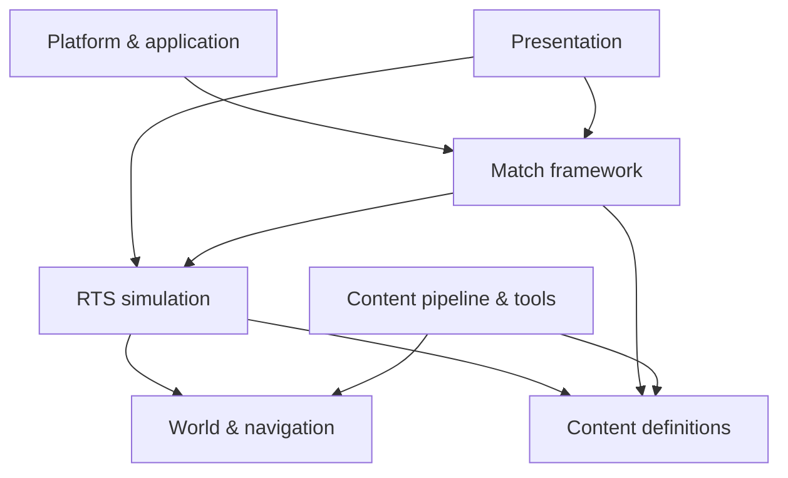

# POLITIKA — Proposed Engine Layers

Status: first-pass architecture proposal, 2026-10-27
Target runtime: Unreal Engine 5.8.3
Design basis: POLITIKA's gameplay and offline-first requirements
Product constraints: offline play without mandatory account login; no cinematic sequences; desktop 4K-capable UI; adaptable handheld/mobile control and presentation
Platform targets: Linux, Windows, SteamOS/Steam Deck and Android; consoles and Apple platforms under future consideration

**Proposed RTS subsystem boundaries (29 October 2026):** See the [RTS Systems Completeness Matrix](RTS_SYSTEMS_COMPLETENESS_MATRIX.md) and companion [Visibility](RTS_VISIBILITY_AND_INTELLIGENCE.md), [Group Orders](RTS_SELECTION_AND_GROUP_ORDERS.md), [Production](RTS_PRODUCTION_AND_TECHNOLOGY.md), [Opponent AI](RTS_OPPONENT_AI.md), and [Match Persistence](RTS_MATCH_PERSISTENCE_AND_REPLAY.md) contracts for owned data, admission, observation, verification and stage limits. The [Engine Outline](ENGINE_OUTLINE.md) remains the only implementation-sequence authority; these are design specifications, not live subsystems.

## 1. Purpose

This document expands the “Proposed layers” table in [ENGINE_OUTLINE.md](ENGINE_OUTLINE.md). It separates the application shell, gameplay runtime, packaged content, and authoring tools according to POLITIKA's needs, without assuming a particular external game's executable architecture or strategic rules.

The core boundary is:

> The simulation owns gameplay truth. Presentation reads that state and submits player commands. Content defines values and authored scenarios. Platform/application code lets the game start and run locally without requiring an external identity service.

## 2. Layer map

| Layer | Owns | Unreal-facing implementation |
|---|---|---|
| Platform & application | Startup, local settings/saves, input devices, display modes, localization, launch/quit | `UGameInstance`, `UGameUserSettings`, Enhanced Input, `USaveGame`, platform abstraction |
| Presentation | Camera, HUD, menus, visual/audio feedback, animation and in-game dialogue | PlayerController, camera components, UMG/CommonUI, Niagara, Audio, animation systems |
| Match framework | Match/mission lifecycle, players/teams, rules, objectives, pause, victory/defeat and results | GameMode/GameState/PlayerState plus POLITIKA match/mission subsystems |
| RTS simulation | Orders, movement, targeting, combat, health/status, abilities, resources and vision | C++ gameplay systems/components with explicit state and command interfaces |
| World & navigation | Maps, terrain, roads, cover, blockers, playable bounds, pathing and visibility queries | UE World/landscape plus RTS-specific navigation, region/cost and visibility data |
| Content definitions | Factions, units, weapons, abilities, upgrades, objectives, AI and mission parameters | Primary Data Assets/DataTables, reusable C++ behavior types, validated references |
| Content pipeline & tools | Map authoring, import, validation, localization, balance iteration and packaging | UE Editor tooling, WorldBuilder-like authoring workflows, command-line validators/build automation |

These are logical boundaries, not a demand for seven separate binaries or modules. Start with a small number of Unreal modules and preserve the dependencies shown below; split modules when the codebase needs independent ownership or build boundaries.

## 3. Layer responsibilities and acceptance criteria

### 3.1 Platform & application

POLITIKA responsibility: provide a direct path from process launch to the main menu and local play. Own settings, display/resolution changes, input-device setup, local profile/save data, language selection, and orderly shutdown. A missing network connection must not prevent campaign or local skirmish access. Do not require account creation, sign-in, or remote entitlement checks for offline content.

UE direction: use GameInstance-level startup/settings coordination, GameUserSettings for display/scalability, Enhanced Input for device and mapping setup, and SaveGame/local config for progress and options. Hide platform-specific storage and distribution details behind a small adapter so game rules do not depend on Steam or another storefront.

Acceptance criteria: campaign and local skirmish launch with networking disabled. Settings, resolution, language selection and local progress work without account creation or third-party services. Platform-specific concerns remain isolated from gameplay code. Validate startup, storage and inputs on Linux, Windows, SteamOS/Steam Deck and Android rather than assuming desktop behavior extends to handheld/touch devices.

### 3.2 Presentation

POLITIKA responsibility: make battlefield state understandable and commands responsive across mouse/keyboard, handheld controller and touch interaction profiles. Own camera controls, selection presentation, HUD, menus, cursor/target modes, alerts, animation, VFX, sound, and in-game dialogue/subtitles. Presentation must not be authoritative for health, resources, objective completion, or order validity.

UE direction: PlayerController translates input; UMG/CommonUI presents menus and HUD; camera components own view motion; animation, Niagara, and Audio respond to game events. UI view models subscribe to state changes rather than polling every entity. Use authored radio dialogue, captions, briefings, and mission events for narrative; cinematic playback is outside POLITIKA's product scope.

Acceptance criteria: selection changes update the HUD promptly; mouse and hotkey commands use one coherent action model; feedback stays legible during active combat. Narrative information is delivered through gameplay, dialogue and briefing interfaces rather than required cinematics.

### 3.3 Match framework

POLITIKA responsibility: start, configure, run, and end a campaign mission or skirmish. Own teams, player slots, mission rules, objective state, pause policy, victory/defeat, result summaries, and transition to the next local screen. Keep campaign progression separate from per-match state so local saves and mission restarts are predictable.

UE direction: use GameMode for authoritative rules, GameState for match-wide state, PlayerState for player-owned state, and purpose-built subsystems/components for mission/objective orchestration. Treat online replication as a future adapter only if multiplayer is selected; do not make it a prerequisite for local game lifecycle.

Acceptance criteria: missions can start, pause where permitted, complete, fail and restart without stale state. Objectives and result summaries follow match rules, and local campaign progress is saved independently of a running match.

### 3.4 RTS simulation

POLITIKA responsibility: resolve player and AI commands into authoritative game state: movement and formation, target selection, combat/damage, abilities, unit status, resources, ownership, detection, fog/intel, and squad behavior. Emit events for presentation and objectives. Define explicit state ownership and update-order rules even if cross-machine deterministic lockstep is not required.

UE direction: implement shared rules in C++ systems/components and expose command/query APIs. Keep presentation effects, widget state, and authored one-off mission sequences outside the simulation authority. Serialize the state needed for local saves and potential replay.

Acceptance criteria: identical valid orders and equivalent starting states produce testable gameplay outcomes independent of UI or VFX. State transitions, order rejection and save-state restoration are covered by automated tests; random inputs can be seeded for reproducibility.

### 3.5 World & navigation

POLITIKA responsibility: represent the playable map and provide movement, line-of-sight, targeting, camera-bound, and interaction queries. Support authored terrain, roads, slopes, bridges, cover, buildings, blockers, spawn areas, capture/objective locations, and mission-script regions.

UE direction: use UE World/landscape and asset systems for rendering and scene ownership. Add an RTS-specific navigation/cost representation where general navigation does not adequately model formation movement, tactical terrain costs, or large-scale queries. Keep visibility/fog state player-specific and distinct from what is physically present in the world.

Acceptance criteria: authored spawn points and objectives are reachable under intended navigation rules. Terrain costs, blocked routes, bridges, camera bounds and player-specific fog-of-war state can be inspected and validated in test maps.

### 3.6 Content definitions

POLITIKA responsibility: store tunable authored values and references for factions, squads, vehicles, weapons, abilities, upgrades, objectives, AI profiles, and mission variants. Preserve stable IDs and validation so balance changes do not require duplicating behavior code.

UE direction: use Primary Data Assets or DataTables for definitions, shared C++ components/ability types for behavior, and Blueprint subclasses for presentation or explicitly authored exceptions. Validate missing references, invalid values, unsupported combinations, and localization gaps in editor/build tooling.

Acceptance criteria: a faction or unit can be introduced with validated data assets and reused behaviors, rather than duplicating combat code. Stable identifiers, invalid references, missing localization and unsupported combinations are diagnosed before release.

### 3.7 Content pipeline & tools

POLITIKA responsibility: let designers make and check maps, missions, units, tuning, text, and audio without hand-editing runtime code. Own import/build rules, validation, asset naming/IDs, localization checks, map diagnostics, and reproducible packaging.

UE direction: build editor utilities for map/object placement and validation, data-asset checks, preview/debug overlays, and one-click local test launch. Add standalone command-line validators for CI and bulk data. Keep generated or imported reference material separate from source assets and document provenance.

Acceptance criteria: map/content validators detect missing spawns, broken asset references, invalid objectives and localization gaps before packaging. Designers can launch a representative map for offline testing, with reproducible diagnostics for failures.

**Economy/maintenance ownership (adopted design; source not implemented):** C++ match simulation must own one **in-game USD-cent treasury per participant**, validated gold/fossil stock-sale debit and $ credit, per-building positive minimum electricity load and generation allocation, and per-staffed-force food upkeep plus dollar-funded replenishment. These are separate *kinds of state*, not five interchangeable wallet currencies. A player or AI purchase enters one authenticated fixed-step transaction path; UI views show only authorized $ balances, power status, food and legitimate sale quotes. Stage 4B remains the first bounded proof. The [USD, electricity and food contract](RTS_OPERATIONAL_ECONOMY_AND_POWER.md) owns rates/eligibility/shortage semantics and [Production](RTS_PRODUCTION_AND_TECHNOLOGY.md) owns producers and queues.

### 3.8 Espionage, Intimidation, resources and nuclear ultimate weapons

World canon and rules: Concord and Directorate are the two existing nuclear powers; Ascendancy begins non-nuclear; Meridian and Unaligned remain non-nuclear. Concord's specialist intelligence subdivision, Psy-Ops, can make an eligible combat/non-combat unit self-destruct after fully breaking Discipline/Morale, or cause a brief attack on its own allied units through a timed targeting override. Directorate's ordinary spying is slightly faster and cheaper at stealing rival intelligence. Ascendancy has more limited spying and must fully develop its spy progression before infiltrating a Concord or Directorate nuclear research facility for the two required intelligence unlocks.

Simulation: own espionage upgrade levels, isolation/support evaluation for combat units, identity and ability permissions, covert-action success, capture/transfer of unit control, protection/detection, resource balances, oil-to-petroleum/kerosene refinery jobs, crude-to-processed nuclear-resource refinery jobs, facility power/production, and completed weapon custody. Intimidation is Ascendancy-exclusive and can convert isolated eligible enemy units, not groups protected by allied support. The engine must reject intimidation from any other faction.

Faction permissions: Concord has lower fuel-refining costs, Directorate has far cheaper infantry, Ascendancy has slightly higher unit damage and selected self-sacrificing attacks, and Meridian starts near an existing oil or natural-gas field. Only Concord and Directorate can construct nuclear power plants and produce nuclear bombs with sufficient intelligence, processed material and long production. Meridian cannot refine nuclear materials, and Ascendancy may do so only after fully developed spying and verified Concord/Directorate intelligence infiltration, exclusively to build its first bomb, never a nuclear power plant.

Match framework: issue the immediate Ascendancy win on completion of its first *self-produced* bomb after all eligibility conditions. No deployment or detonation is required. Stolen completed bombs remain deployable finite assets for Ascendancy and Meridian if delivery conditions hold, but do not trigger that victory. Match outcomes must not rewrite the canonical 1989 storyline.

Content/presentation/tools: data assets define refinery recipes, resource rankings, faction bonuses, spy-tree completion requirements, eligible nuclear research facilities, Intimidation users/targets and mission rules. UI shows locked/unlocked infiltration, enemy isolation/Intimidation eligibility, processing queues and the Ascendancy instant-win threat without leaking unknown intelligence. Validators check absent Meridian fossil-fuel spawn nodes, forbidden nuclear refinery/nuclear plant construction, non-max spy infiltration, illegal unit conversion and mismatched own-produced/stolen bomb events.

See [Espionage and Intimidation](ESPIONAGE_AND_INTIMIDATION.md), [Resource Economy](RESOURCE_ECONOMY.md), and [Nuclear Ultimate Weapons System](NUCLEAR_WEAPONS_SYSTEM.md).

### Psy-Ops and espionage economy contracts

The simulation owns Psy-Ops `UnitResolve` depletion and fully-broken self-destruction resolution or temporary friendly-fire rampage, including start, expiry, interruption, valid friendly targets, and preservation of unit ownership. Content definitions gate it to Atlantic Concord only and to eligible combat/non-combat units. UI indicates a target's Discipline/Morale label and short rampage expiry. Red Directorate rival-intelligence theft receives a slight time and resource-cost discount, defined by espionage-operation category rather than blanket spying speed. The match authority validates both effects and prevents them from bypassing Ascendancy's nuclear-intelligence research gates. See [Espionage and Intimidation](ESPIONAGE_AND_INTIMIDATION.md).

### Building espionage, concealed accounting and disruption chains

The simulation and match framework own building-level espionage eligibility, resource transactions and personnel-loss incidents:

- Concord Psy-Ops: eligible enemy-building destruction or a bounded undetected resource-waste sink; resource loss is not credited to Concord.
- Red Directorate: covert eligible enemy resource diversion, with atomic debit at the source and credit to the Directorate's compatible account. Never create resources from nothing or debit an empty budget.
- Iron Ascendancy: abstract poison/disease incident in a staffed building, reducing assigned workers/researchers and therefore throughput, with finite propagation to nearby eligible facilities and recovery through containment/replacement. Do not model real poison or pathogen transmission.

World/spatial code owns eligible neighboring facilities and caps propagation; economy/production owns worker counts and throughput; intelligence/fog owns what the defending player detects and can attribute; presentation shows staff losses, production failures or unexplained budget changes only as permitted by discovery state. Content assets define faction permissions, cost, eligible target types, duration, spread caps, immunity/exclusion flags and counterplay. The Iron Ascendancy nuclear intelligence/full-spy progression remains a separate permissioned objective. See [Espionage and Intimidation](ESPIONAGE_AND_INTIMIDATION.md).

### Early scouting and asymmetric conventional sabotage permissions

Unit content defines cheap, fast, lightly armored and armed Meridian scout-combat trucks; cheap, unarmed Atlantic Concord/Iron Ascendancy light reconnaissance airplanes; and basic-rifle-armed Red Directorate motorbike scouts. Meridian leads overall early reconnaissance efficiency, but every faction uses standard fog-of-war and movement/supply constraints. Visibility alone never counts as intelligence theft or unit sabotage.

The match framework and simulation gate fictional attached-charge conventional sabotage: Meridian accesses it early, cheaply and via eligible non-spy units, whereas the three rival playable factions unlock it later, at higher cost and exclusively through spies. The world layer validates vehicles/buildings as targets and manages charge status, conventional explosion, damage, defenses and attribution. Unit-category tags must distinguish `Spy`, `Scout`, `Saboteur` and `Civilian` without treating the categories as mutually exclusive unless authoring explicitly requires it. An ordinary rival scout must fail the sabotage command even when it can see or reach the target.

Presentation provides build-card scout roles, no weapon button on unarmed planes, valid sabotage target cues, costs/unlocks, and discovery versus actual operation state. These rules do not permit the Pact to manufacture nuclear weapons or bypass Ascendancy nuclear spy research. See [Reconnaissance and Scouting](RECONNAISSANCE_AND_SCOUTING.md) and [Explosive Sabotage](SABOTAGE_SYSTEM.md).

### Shared resolve, combat Discipline and civilian Morale

Simulation truth: one `UnitResolve` per eligible unit, with shared limits, break threshold, loss and recovery. Presentation label: `Discipline` for combat units and `Morale` for civilian/non-combat units. These must not become different meters or independent health/status systems. Faction Population Morale is a rolled-up civilian/public indicator within the same morale/resolve model, impacting production output and the baseline Discipline of soldiers.

Combat-unit modifiers only: larger coordinated groups stabilize Discipline for Directorate, Ascendancy, Meridian and Unaligned; Directorate and Ascendancy alone get an extra very-massive-army Discipline bonus. Concord alone ignores the solo/small-group Discipline penalty. No such army-size modifier belongs to civilian Morale.

Intimidation ownership: Ascendancy may intimidate eligible isolated combatants or non-combat units. The authoritative transition is `isolated/eligible → UnitResolve reduced to BrokenThreshold → validated ownership change`. Target category changes the label, not the conversion algorithm. Save/replay should preserve resolve and unit ownership while remaining deterministic. See [Propaganda and Morale](PROPAGANDA_AND_MORALE.md) and [Espionage and Intimidation](ESPIONAGE_AND_INTIMIDATION.md).

### Propaganda and morale layer responsibilities

Simulation: track a distinct population morale meter for each of the five factions; high morale improves authorized production output and army discipline. Propaganda modifiers, decay and media reach must be authoritative. Match/faction rules: allow advanced propaganda actions for Atlantic Concord, Red Directorate, Iron Ascendancy and NPC Unaligned, but not Meridian Pact. World/content: define radio, newspaper production/distribution and television infrastructure and its ownership, power and access. Presentation: display every faction's relevant morale and explain production/discipline effects, showing propaganda controls only where eligible.

The Unaligned's federal media operations remain AI-governed; Meridian still receives morale from ordinary game events. No propaganda effect may create missing nuclear technology or resources or change the unique Ascendancy first-bomb victory predicate. See [Propaganda and Morale](PROPAGANDA_AND_MORALE.md).

### NPC counterintelligence and balance-preserving deception ownership

The match framework owns strategic-strength observations for the two to four real playable participants and the thresholds for imminent elimination. The Unaligned NPC director uses these observations to decide whether balance-preserving intervention is warranted. It may choose fabricated threat reports, misleading nuclear-facility information or false-flag attribution to distract stronger rivals, but cannot command other players, fabricate real facilities or cancel an earned victory.

The intelligence layer owns source provenance, intercepted factual records, manufactured `IntelClaim` objects, intended recipients, confidence, verification, expiry and attribution. World/simulation remains ground truth for buildings, resource inventories, true nuclear research, troop positions, scouting and victory events. Fog-of-war and UI show reports as uncertain claims rather than confirmed structures. NPC propaganda may disseminate a claim more broadly if the operation requires it. Discovery and correction can affect legitimacy and population Morale through authorized events.

Implement bounded costs, cooldowns, source coverage and counterintelligence defenses; test against a two-player match, several rival players, exhausted resources, missing target factions and the Ascendancy instant-win transition. The Unaligned's anti-Ascendancy hostility is unaffected by general balancing logic. See [Unaligned Counterintelligence](UNALIGNED_COUNTERINTELLIGENCE.md).

### Match roster, controllers and neutral world separation

Match framework: enforce 2–4 occupied player-faction slots with exactly one distinct playable faction per participant/controller, selected from Concord, Directorate, Ascendancy and Meridian. World/simulation: instantiate one autonomous Unaligned system-AI faction in addition to—not within—those slots. A standard map thus has 3, 4 or 5 active faction presences (2+1, 3+1, 4+1). Offline play permits one human plus AI opponents to occupy the 2–4 playable slots.

Content/map validation: confirm four-faction pool, one-to-one player/faction assignments, Unaligned existence, legal faction spawns, Meridian fossil-field proximity where applicable, and applicable Concord/Directorate research-facility prerequisites if Ascendancy nuclear victory is available. Presentation: label player slots separately from the always-present NPC Unaligned; never imply that Unaligned is a selectable or fifth human faction. See [Match Structure](MATCH_STRUCTURE.md).

## 4. Dependency and ownership rules

- Platform code may start or configure a match, but simulation rules should not call into storefront/account code.
- Presentation reads view state and submits commands; it never becomes the source of gameplay truth.
- Match framework coordinates lifecycle and objectives; detailed movement/combat rules belong to simulation systems.
- Simulation queries world/navigation and data definitions through explicit interfaces; it emits state changes for UI/audio/VFX.
- Content definitions reference behavior types, not arbitrary hidden executable logic.
- Tools validate and generate content, but packaged runtime content must not depend on the editor being installed.
- Local play remains fully functional with the network unavailable. If online features are later added, they must sit above the local match/content layers.

## 5. Suggested implementation order

1. Establish the UE project, startup path, local settings/save boundary, input/display options, and basic module ownership; define platform build targets and reusable command intents for Linux, Windows, SteamOS/Steam Deck and Android.
2. Build a minimal presentation + simulation slice: camera, selection, orders, one unit matchup, one objective, and readable 4K HUD.
3. Add match/mission lifecycle, local pause/restart/save behavior, and data-defined unit/weapon/ability content.
4. Add world navigation/visibility rules and editor validation for a representative map.
5. Add AI, campaign authoring, audio/dialogue/subtitles, mission debrief, and skirmish setup.
6. Profile and scale; add multiplayer/replay adapters only after product requirements are decided.

## 6. Implementation assumptions and validation boundary

The design currently assumes:

- Unreal Engine 5.8.3 for the runtime, editor, packaging and asset pipeline.
- An offline-first application with local campaign and skirmish access, local settings and saved progress, and no mandatory sign-in.
- In-game briefings, radio dialogue, subtitles and mission events in place of required cinematic sequences.
- C++ ownership of gameplay rules; Unreal-native assets and editor tooling for configurable content; 4K-capable desktop presentation with device-adaptive handheld and Android layouts.
- Multiplayer, networking, replay architecture and the exact economy/deployment model remain contingent on explicit product decisions.

See [Platform Support and Portability Plan](PLATFORM_SUPPORT.md) for the planned build matrix, input contracts, device-level acceptance and possible later platform expansion.

These are POLITIKA design requirements and proposals, not verified implementation results. Validate them with source-level reviews, functional prototypes, automated tests, map checks and representative performance measurements. Do not treat planned systems as implemented until their behaviour has been demonstrated.
