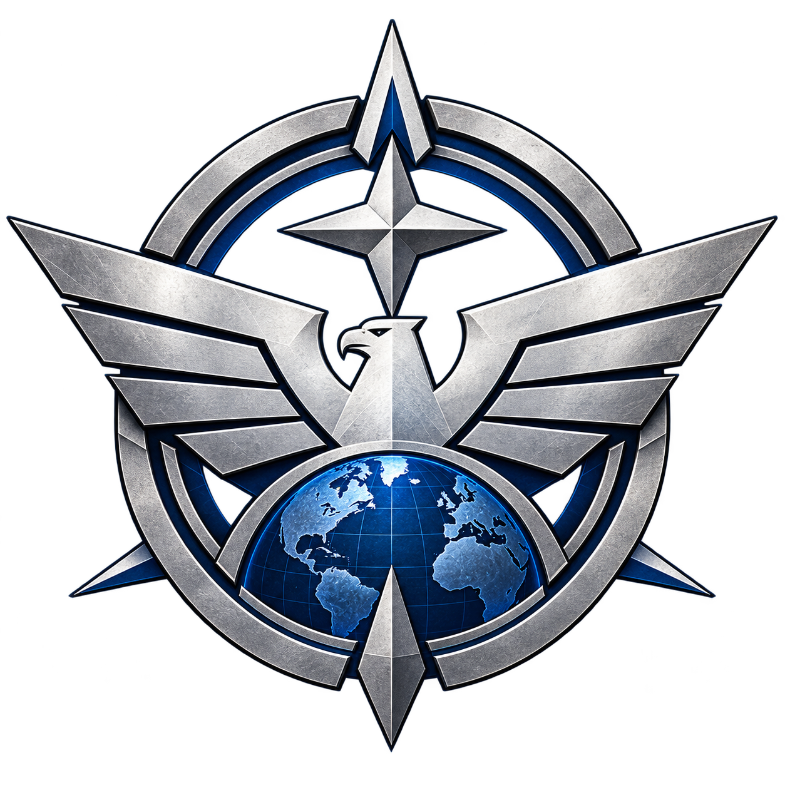
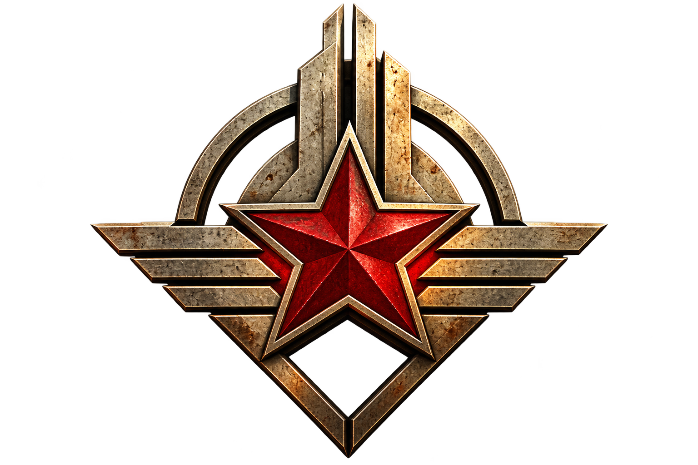
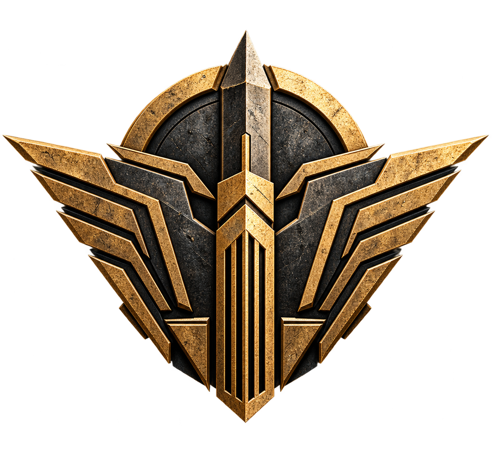
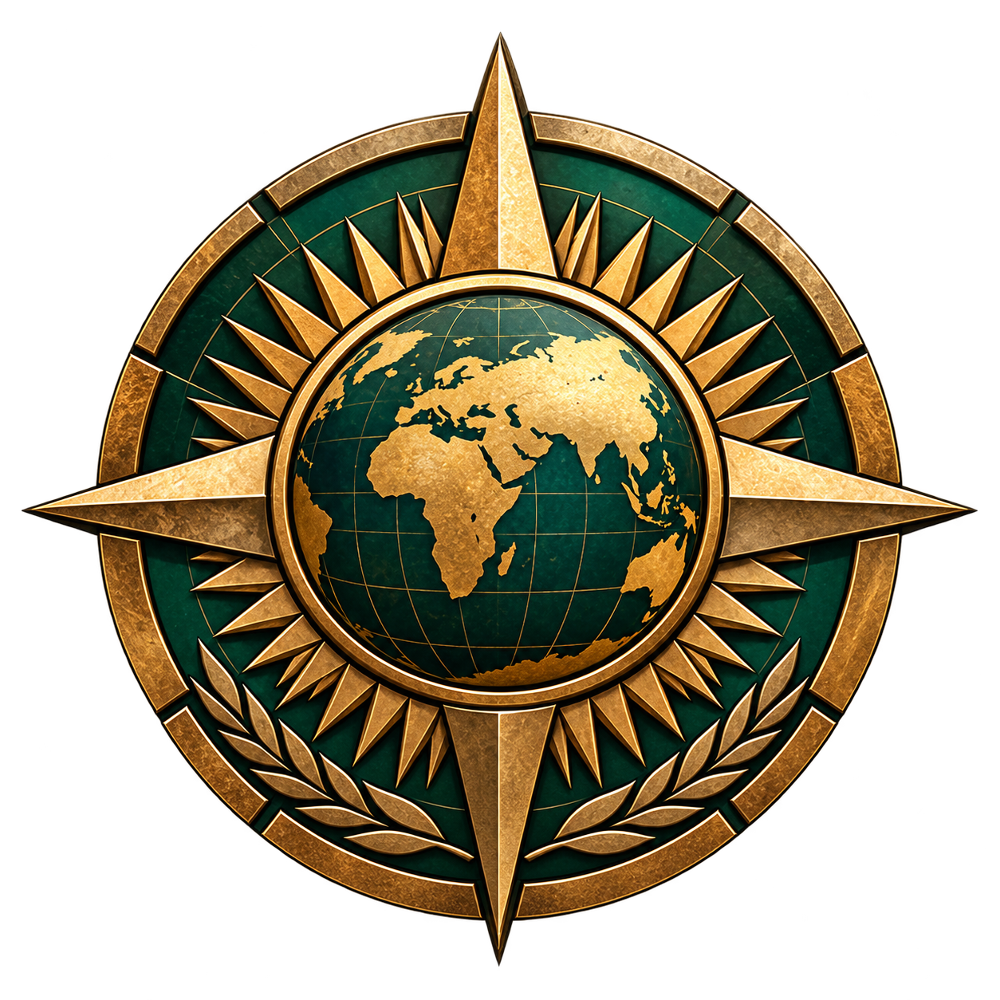
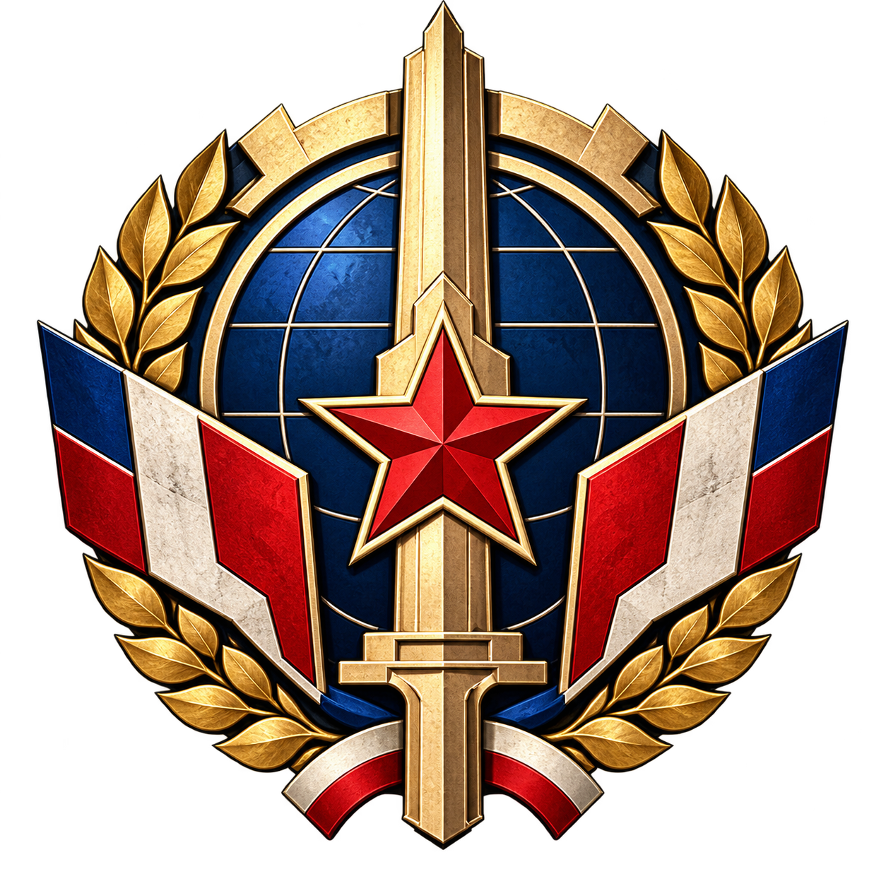

# POLITIKA

An alternate-history real-time strategy game set in Yugoslavia, 1984–1989.

POLITIKA combines asymmetric military strategy, Cold War espionage, political intrigue, nuclear brinkmanship, and competing ideologies in a fictionalized 1980s Yugoslavia. Three rival geopolitical powers struggle for influence, a fourth playable faction brokers weapons and mercenaries, and the Yugoslav federation itself operates as a persistent, AI-controlled authority.

The country is more than a battlefield. Its cities, industries, transport networks, armed forces, civilians, borders, and institutions form a living political environment. Players must decide when to cooperate with that environment, when to operate secretly within it, and when the consequences of open conflict are worth the cost.

> Project status: POLITIKA has a native Unreal application shell and a bounded RTS prototype with selection, movement, combat, one control-point objective, and an accepted typed command/simulation contract. The prototype lifecycle and initial participant-authority foundation are qualified for Linux UE 5.8.3 Development, including objective-driven exactly-once results, event publication, simulation shutdown, return/recovery, cooked schema and malformed-participant rejection, rendered same-process canonical Active retry, authored two-slot ownership/faction mapping, and controller-bound local input; see the [Stage 4A lifecycle acceptance record](Docs/STAGE4A_MATCH_LIFECYCLE_ACCEPTANCE.md). This does not complete the broader Stage 4A match framework, a rules-complete single-player match, First Playable Skirmish, campaign, or release/platform qualification. See the [RTS vertical-slice acceptance record](Docs/RTS_VERTICAL_SLICE_MILESTONE.md), [command/simulation contract record](Docs/RTS_COMMAND_SIMULATION_CONTRACT.md), and [shell build and verification guide](Docs/SHELL_SKELETON.md). Standard faction orchestration, autonomous Unaligned behavior, economy/deployment, AI, visibility, full victory/defeat rules, persistence, faction rosters, and balance remain incomplete or design-stage.

## Versioning and release management

**Current development identity: 0.1.0-dev.0** — an initial development identity, **not** a playable RTS or public release. POLITIKA uses Semantic Versioning and separate compatibility counters, with [version.json](version.json) as the canonical manifest. The initial local-profile format is schema 1; campaign, network and world contracts remain unimplemented. Runtime startup diagnostics include the generated canonical version and Git build identity.

Verified development milestones can advance the version through dev, alpha, beta and release-candidate stages toward stable releases. Contributors and development agents may perform justified bumps alongside validated work; ordinary documentation/archive commits do not automatically increase the version. Future builds will record their Git revision, CI build number, engine/platform and artifact integrity independently from the public version.

See the [Versioning, Build Identity & Release Management Roadmap](Docs/VERSIONING_RELEASE_MANAGEMENT_ROADMAP.md) and [Changelog](CHANGELOG.md). The source-checking and build-identity utility is a [Rust Cargo package](tools/version/Cargo.toml), with Rust unit tests and manual Cargo validation commands. Versioning tools and tests run natively through Cargo.

## Target platforms

POLITIKA is designed as a **multi-platform RTS**, with **Linux, Windows, SteamOS (including Steam Deck-class handheld PCs), and Android** in its planned initial platform scope. These are development targets—not available builds, verified compatibility claims, or a confirmed simultaneous release schedule.

| Platform | Product target | Primary interaction |
|---|---|---|
| **Linux** | Native desktop release target | Keyboard and mouse, plus planned controller/gamepad support with configurable RTS bindings; scalable desktop HUD |
| **Windows** | Native desktop release target | Keyboard and mouse, plus planned controller/gamepad support with configurable RTS bindings; scalable desktop HUD |
| **SteamOS / Steam Deck** | Handheld PC compatibility target, including portable performance and control layouts | Gamepad/Steam Input-style controls, with touchscreen or external peripherals where available; native Linux versus compatibility-layer delivery to be validated |
| **Android** | Mobile release target | Touch-oriented RTS controls and adaptive menus/HUD, with controller support considered where practical |

The same campaign, factions, match rules, AI and offline-first single-player design should be shared across platforms. Platform-specific controls, layouts, graphics presets, packaging and performance budgets must adapt to the available device. The desktop 4K presentation target must not be imposed on small handheld or mobile screens. Release timing, supported hardware, deployment methods and parity will depend on practical prototyping and testing.

**Possible later expansion:** PlayStation, Xbox and Nintendo console families, plus Apple platforms (macOS and potentially iOS/iPadOS). These are exploratory future possibilities, not committed launches; they depend on platform access, porting feasibility, performance, certification and maintenance capacity. Nothing here promises console certification, Steam Deck Verified status, cross-play or cross-platform saves.

See the [Platform Support and Portability Plan](Docs/PLATFORM_SUPPORT.md) for the platform matrix, input strategy, technical boundaries and validation requirements.

## The setting

POLITIKA takes place in an alternate-history Socialist Federal Republic of Yugoslavia during the final years of the Cold War. The federation stands at the intersection of rival political and economic systems, yet is neither an Atlantic satellite nor a subordinate of the Soviet-style bloc. Its distinctive combination of socialist self-management, federal institutions, and nonalignment makes it both strategically valuable and difficult for outside powers to control.

The campaign spans 1984–1989, moving through intelligence operations, border incidents, infrastructure crises, political disputes, and escalating military confrontation. The world draws on Yugoslavia's republics and autonomous provinces, the Yugoslav People's Army (JNA), Territorial Defence, federal and local administration, economic institutions, and the complex international relationships of the period.

This is fiction, not a claim about real history. Josip Broz Tito died on 4 May 1980 in reality. In POLITIKA's timeline, he survives beyond that date. What happens to him in 1984—and what Yugoslav authorities subsequently conceal—drives the central conspiracy.

## Five factions, different roles

Four factions are playable, but they serve deliberately different strategic roles. The Atlantic Concord, Red Directorate, and Iron Ascendancy are the three principal geopolitical rivals. The Meridian Pact is a specialist playable faction built around trade and mercenary services. The Unaligned represents the AI-controlled Yugoslav state and its institutions; it is always present in the game world and never available as a player faction.

| Faction | Role | Strategic character |
|---|---|---|
|  [The Atlantic Concord](Factions/TheAtlanticConcord/description.md) | Principal playable rival | Western-inspired parliamentary and market-oriented coalition emphasizing professional forces, technology, intelligence, air power, and precise military operations. |
|  [The Red Directorate](Factions/TheRedDirectorate/description.md) | Principal playable rival | Soviet-inspired centralized socialist power emphasizing industrial mobilization, armored forces, artillery, engineering, and large-scale sustained operations. |
|  [The Iron Ascendancy](Factions/TheIronAscendancy/description.md) | Principal playable rival | Fictional fascist and supremacist authoritarian power emphasizing clandestine action, coercion, destabilization, and aggressive asymmetric warfare; faces exceptional hostility from Yugoslav authorities when identified. |
|  [The Meridian Pact](Factions/TheMeridianPact/description.md) | Specialist playable faction; merchant and mercenary network | Strategically independent trading and mercenary coalition emphasizing procurement, mobility, the Black Market, and unconventional operations. |
|  [The Unaligned](Factions/TheUnaligned/description.md) | NPC / system AI only | The Yugoslav federation: civil administration, armed forces, police, borders, infrastructure, and civilian society. Generally neutral, but capable of enforcing its authority and responding to threats. |

Only the Concord and Directorate begin as nuclear powers. The Ascendancy pursues a distinctive nuclear acquisition and victory objective, while the Meridian Pact is a non-nuclear commercial power. The Unaligned regulates the shared world rather than competing as a conventional fifth army. These strategic differences shape faction identity, but their individual unit abilities, resource rules, espionage effects, and victory conditions belong in the design documents, not this introduction.

For faction-specific gameplay concepts, see the [Concepts Outline](Docs/CONCEPTS_OUTLINE.md); for detailed political and visual identities, see the [faction descriptions](Factions/).

## Core gameplay direction

POLITIKA retains the direct tactical foundations of a classic RTS—commanding forces, positioning, scouting, production, and combat—while making political authority, information, commerce, and infrastructure meaningful elements of strategic play.

Its intended design rests on asymmetric factions, a living neutral Yugoslav world, intelligence and counterintelligence, resource and supply constraints, trading and mercenary services, and military objectives that interact with the broader political situation. Players must establish a presence, gather information, acquire resources, act, and manage the consequences. The importance of each element varies by faction, scenario, and mode.

Concrete gameplay proposals—including early reconnaissance units, conventional sabotage, espionage and Psy-Ops, nuclear technologies and special victories, morale and propaganda, Black Market rules, and autonomous NPC interventions—are maintained in the [Concepts Outline](Docs/CONCEPTS_OUTLINE.md). More detailed specifications are linked in the [documentation guide](#documentation-and-repository-guide). These remain design intentions until implemented and tested.

## Two interwoven storylines spanning five years

The primary campaign storyline is built around a single, exceptionally sensitive political secret. What first appears to be an assortment of military incidents and Cold War intelligence disputes gradually reveals a hidden struggle over the legitimacy and survival of the Yugoslav federation.

The four playable factions encounter different portions of the truth, act on incomplete information, and face conflicting incentives. The Iron Ascendancy has particular knowledge of the original crime; the other factions follow separate diplomatic, military, economic, and intelligence leads. The Unaligned attempts to maintain public order while an inner security apparatus protects a secret whose exposure could destroy the legitimacy of the state itself.

Alongside the central conspiracy, a secondary conflict concerns the Iron Ascendancy's attempt to acquire nuclear weapons and the efforts of the Concord and Directorate to prevent it. This race also informs the game's asymmetric objectives; production, espionage, delivery, and victory rules are documented in the [Concepts Outline](Docs/CONCEPTS_OUTLINE.md) and [Nuclear Ultimate Weapons System](Docs/NUCLEAR_WEAPONS_SYSTEM.md).

The planned campaigns follow a shared 1984–1989 chronology. Player choices shape tactical outcomes, the survival of witnesses, the custody of evidence, faction influence, and the consequences of individual operations. They do not rewrite the foundational mystery or its canonical conclusion.

Central narrative premise and ending — major spoilers

In 1984, agents of the Iron Ascendancy assassinate Tito by arranging for his food to be poisoned. A small group within the Unaligned's highest security apparatus conceals the killing to prevent a perceived crisis of national unity.

A body double replaces Tito during tightly controlled public appearances, while a separate voice double supplies radio broadcasts, recordings, and propaganda. Neither double actually governs: a clandestine circle issues decisions in Tito's name. Officials and witnesses who approach the truth may be intimidated, detained, discredited, or silenced.

The assassination cell and the Yugoslav cover-up are distinct conspiracies: the Iron Ascendancy commits the murder, but it does not control the federal decision to conceal it. Evidence survives through medical records, security logs, recordings, witnesses, and operational documentation.

In 1989, corroborating evidence finally becomes public. The revelation of the murder and years of deception destroys the credibility of the institutions that claimed to preserve the federation. Combined with existing economic, constitutional, political, and regional tensions, it precipitates Yugoslavia's disintegration into war in the game's canonical ending.

For the complete act-by-act chronology, principal character functions, and mission ideas, see the [Story Outline](Docs/STORY_OUTLINE.md) (contains full spoilers).

## Planned modes and presentation

The planned campaign presents faction-specific missions within a shared 1984–1989 narrative. Briefings, radio traffic, intelligence reports, documents, objectives, and debriefings carry the story alongside regular RTS play.

Skirmish is intended to provide self-contained battles against AI opponents, independent of the campaign's fixed ending. Matches include a persistent Unaligned world authority alongside the selected playable factions. Match composition and faction-slot rules are covered in [Match Structure](Docs/MATCH_STRUCTURE.md).

Multiplayer and scenario/editor support remain possible later extensions, not confirmed first-release features. The immediate aim is offline-first single-player campaign and skirmish without mandatory internet access, external accounts, or sign-in.

## Technology and interface

POLITIKA's proposed technical foundation is Unreal Engine 5.8.3, with primarily C++ gameplay and RTS simulation systems, Unreal-native content assets, and a clear separation between authoritative game state and its visual presentation. Map authoring, faction definitions, unit data, AI, missions, and validation tools are intended to be maintainable and data-driven.

The desktop interface is being designed for readable tactical control at 4K (3840 × 2160), with device-appropriate layouts and interaction models for handheld and Android screens. Its visual direction takes cues from 1980s Yugoslav topographic maps, field reports, military documentation, and civil-administration materials, without sacrificing clarity, accessibility, or command responsiveness.

These are architecture and product targets, not evidence that the corresponding engine systems already exist. The exact economy, multiplayer scope, performance targets, and several simulation decisions remain under design.

## Documentation and repository guide

The main README introduces the project; concrete gameplay concepts and system-level design belong in the linked documents. The [Concepts Outline](Docs/CONCEPTS_OUTLINE.md) is the starting point for proposed mechanics, faction interactions, and unresolved design questions.

| Location | What it contains |
|---|---|
| [Story Outline](Docs/STORY_OUTLINE.md) | Canonical 1984–1989 narrative and campaign progression (spoilers). |
| [Concepts Outline](Docs/CONCEPTS_OUTLINE.md) | Central gameplay concepts, faction asymmetry, proposed systems, and open decisions. |
| [Resource Economy](Docs/RESOURCE_ECONOMY.md) | Resources, refining, power, and faction economies. |
| [Propaganda and Morale](Docs/PROPAGANDA_AND_MORALE.md) | Political influence, media, population morale, and unit resolve. |
| [Unaligned Counterintelligence](Docs/UNALIGNED_COUNTERINTELLIGENCE.md) | AI intelligence, deception, and faction-balance responses. |
| [Reconnaissance and Scouting](Docs/RECONNAISSANCE_AND_SCOUTING.md) | Reconnaissance-unit concepts and visibility rules. |
| [Explosive Sabotage](Docs/SABOTAGE_SYSTEM.md) | Conventional sabotage and faction eligibility. |
| [Espionage, Psy-Ops and Intimidation](Docs/ESPIONAGE_AND_INTIMIDATION.md) | Covert actions, infiltration, facility effects, and intimidation. |
| [Nuclear Ultimate Weapons System](Docs/NUCLEAR_WEAPONS_SYSTEM.md) | Nuclear resources, weapons, delivery, theft, and victory rules. |
| [Match Structure](Docs/MATCH_STRUCTURE.md) | Playable faction slots, AI participation, and match constraints. |
| [Engine Outline](Docs/ENGINE_OUTLINE.md) | Proposed Unreal Engine RTS foundation and priorities. |
| [Platform Support and Portability Plan](Docs/PLATFORM_SUPPORT.md) | Platform targets, portability, input, and validation. |
| [Proposed Engine Layers](Docs/PROPOSED_ENGINE_LAYERS.md) | Technical separation of game systems and presentation. |
| [Documentation Index](Docs/DOCUMENTATION_INDEX.md) | Ownership and navigation for gameplay, engineering, production, research and release documents. |
| [Production Standards](Docs/PRODUCTION_STANDARDS.md) | Historical decision gates, map-source lineage, RTS-distance 3D/visual rules and planned audio catalogue. |
| [Validation and Governance](Docs/VALIDATION_AND_GOVERNANCE.md) | Scope-appropriate Rust/C++ checks, evidence and documentation ownership. |
| [Performance and Release Gates](Docs/PERFORMANCE_AND_RELEASE_GATES.md) | Unexecuted RTS benchmark fixtures, platform qualification and blocked release criteria. |
| [Development Foundations](Docs/DEVELOPMENT_FOUNDATIONS.md) | Rust/C++20 regression tests, RTS content audit, UE 5.8.3 preflight, diagnostic verdicts, and staged automation without hosted workflows. |
| [UI Overview](Docs/POLITIKA_UI_OVERVIEW.md) | Controls, interface, accessibility, and presentation. |
| [Faction files](Factions/) | In-depth faction descriptions, logos, and banners. |
| [Historical Reference Archive](Archive/README.md) | 194 sourced research records: 69 political developments, 94 cartographic references and 31 foundational historical/media sources, with source-rights and alternate-history safeguards. [Map atlas](Archive/MAPS_1980_1989.md) · [Map acquisition workflow](Archive/MAP_ACQUISITION_GUIDE.md). |

## Development and contributions

POLITIKA is a developing independent RTS project with an Unreal application shell and a bounded, locally verified gameplay prototype. Further implementation and documentation are developed against the design materials, with changes evaluated for consistency with the alternate-history canon and the asymmetrical, neutral-world gameplay design.

Feedback, bug reports, design discussions, documentation improvements, and contributions can be proposed through this repository's [issues](https://github.com/simon-gros/politika/issues) and pull requests. Proposed features should distinguish between established canon, design proposals, and working implementations, and should not treat planned mechanics as already completed.

Licensing note: The repository does not currently contain a standalone LICENSE file. A public repository is not automatically a grant of rights to reuse or redistribute its contents; licensing terms should be clarified before assuming those permissions.

---

*POLITIKA is an independent game project inspired by classic real-time strategy design. It is not an official Command & Conquer title and is not affiliated with that franchise's rights holders.*
